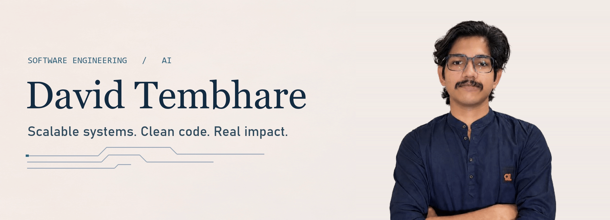
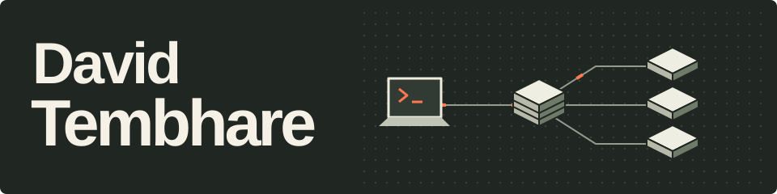
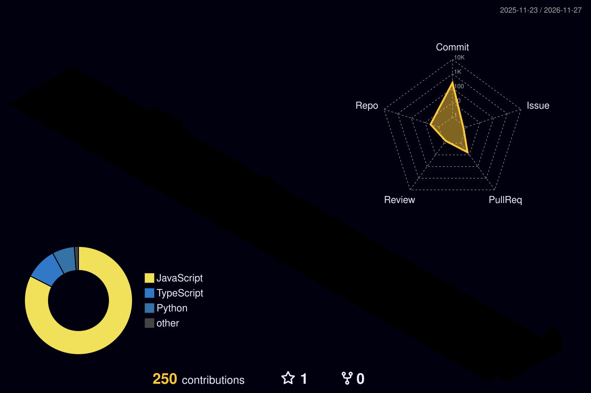

<div align="center">

  <!-- ==================== HEADER BANNER ==================== -->
  <picture>
    <source media="(prefers-color-scheme: dark)" srcset="https://raw.githubusercontent.com/David-2610/David-2610/main/david-profile-banner.gif">
    <source media="(prefers-color-scheme: light)" srcset="https://raw.githubusercontent.com/David-2610/David-2610/main/david-profile-banner.gif">
    
  </picture>

  <br/><br/>

  <!-- ==================== DYNAMIC TYPING SVG (FIXED WIDTH & PADDING) ==================== -->
  <a href="https://git.io/typing-svg">
    <picture>
      <source media="(prefers-color-scheme: dark)" srcset="https://readme-typing-svg.demolab.com?font=Fira+Code&weight=600&size=20&pause=1200&color=00F0FF&center=true&vCenter=true&width=820&height=50&lines=Software+%26+Systems+Developer;Full-Stack+%26+Distributed+Systems+Builder;Multi-Agent+AI+Architectures+(LangChain+%7C+LangGraph);GDG+Organizer+%7C+E-CODE+Club+Head;Competitive+Programmer+(LeetCode+1466+%7C+CF+773)">
      <source media="(prefers-color-scheme: light)" srcset="https://readme-typing-svg.demolab.com?font=Fira+Code&weight=600&size=20&pause=1200&color=0284C7&center=true&vCenter=true&width=820&height=50&lines=Software+%26+Systems+Developer;Full-Stack+%26+Distributed+Systems+Builder;Multi-Agent+AI+Architectures+(LangChain+%7C+LangGraph);GDG+Organizer+%7C+E-CODE+Club+Head;Competitive+Programmer+(LeetCode+1466+%7C+CF+773)">
      
    </picture>
  </a>

  <br/>

  <!-- ==================== SOCIAL & IDENTITY BADGES ==================== -->
  <p align="center">
    <a href="https://linkedin.com/in/david-tembhare-74960b29a">
      
    </a>
    &nbsp;
    <a href="mailto:davidtembhare1005@gmail.com">
      
    </a>
    &nbsp;
    <a href="https://leetcode.com/david-2610/">
      
    </a>
    &nbsp;
    <a href="https://codeforces.com/profile/David-2610">
      
    </a>
    &nbsp;
    <a href="https://www.geeksforgeeks.org/user/davidtembhare/">
      
    </a>
    &nbsp;
    
  </p>

  <!-- Animated Neon Divider -->
  

</div>

<br/>

<!-- ==================== ABOUT ME ==================== -->
## 👨‍💻 About Me

```yaml
name: David Tembhare
role: Software and Systems Developer
education: B.Tech in CSE (Artificial Intelligence) @ University of Allahabad (CGPA: 8.1/10)
location: Prayagraj, India
current_focus: Distributed Systems, Low-Latency Networks, Multi-Agent AI Pipelines
leadership: Club Head @ E-CODE | Organizer @ Google Developer Groups (GDG)
portfolio_portal: https://www.e-code.site
```

- 🚀 **Software & Systems Developer** passionate about architecting scalable full-stack web applications, resilient local and distributed infrastructure, and agentic AI systems.
- ⚡ **Club Head at E-CODE**: Directed a 10-member engineering and events team. Architected and deployed **CodeClash**, an offline browser-based LAN contest platform with custom submission queues and live leaderboards for **Code Clash 1.0**.
- 🌐 **GDG Organizer**: Leading technical architecture for a 24-hour CTF, designing challenge categories, scoring algorithms, and real-time leaderboard infrastructure.
- 💼 **Industry Track Record**: 
  - Shipped production features at **Online Dimensions** (serving 30,000+ MAU; reduced data retrieval latency by ~30%).
  - Delivered the official website for **DESIFEST 2026** (150,000+ annual attendees).
- 🏆 **Hackathon & Contest Winner**: Ranked **#103 out of 1,971 teams** in the 16th April AI Challenge (Multi-Agent Fraud Detection) and awarded **Second Runner-Up** at the Stellaris 2026 Hackathon (FinPilot).

<br/>

<div align="center">
  
</div>

<!-- ==================== TECH STACK (WITH TEXT & LOGOS) ==================== -->
## 🛠️ Tech Stack & Technologies

> *Every technology includes both its official brand icon and clear text designation.*

### 💻 Programming Languages
<p align="left">
  
  &nbsp;
  
  &nbsp;
  
</p>

### 🌐 Frontend & UI Engineering
<p align="left">
  
  &nbsp;
  
  &nbsp;
  
  &nbsp;
  
  &nbsp;
  
</p>

### ⚙️ Backend & API Development
<p align="left">
  
  &nbsp;
  
  &nbsp;
  
</p>

### 🗄️ Databases & Caching
<p align="left">
  
  &nbsp;
  
  &nbsp;
  
</p>

### 🤖 AI, Machine Learning & Agentic Systems
<p align="left">
  
  &nbsp;
  
  &nbsp;
  
  &nbsp;
  
  &nbsp;
  
  &nbsp;
  
</p>

### 🖥️ Systems, Networks & DevOps Infrastructure
<p align="left">
  
  &nbsp;
  
  &nbsp;
  
  &nbsp;
  
  &nbsp;
  
  &nbsp;
  
  &nbsp;
  
</p>

### 🧰 Developer Tools & Workflow
<p align="left">
  
  &nbsp;
  
  &nbsp;
  
</p>

<p align="center">
  
</p>

<br/>

<div align="center">
  
</div>

<!-- ==================== FEATURED PROJECTS ==================== -->
## 🚀 Featured Projects

<table>
  <tr>
    <td width="50%" valign="top">
      <h3 align="center"><a href="https://github.com/David-2610/Coding-Contest-LAN">⚡ CodeClash LAN Contest Engine</a></h3>
      <p align="center">
        <a href="https://www.e-code.site"></a>
        <a href="https://github.com/David-2610/Coding-Contest-LAN"></a>
      </p>
      <p>High-performance browser-based coding contest platform built for offline/air-gapped campus environments. Hosted on a Linux laptop with local Wi-Fi & DNS routing, JSON-defined problem test suites, automated judge queuing, client monitoring, and real-time live leaderboards. Powered University of Allahabad's <b>Code Clash 1.0</b>.</p>
      <p align="center">
        
      </p>
      <p><b>Tech Stack:</b> <code>Python</code> · <code>Linux</code> · <code>LAN / DNS</code> · <code>WebSockets</code> · <code>System Design</code></p>
    </td>
    <td width="50%" valign="top">
      <h3 align="center"><a href="https://github.com/David-2610/Multi-Agent-Fraud-Detection-System">🛡️ Multi-Agent Fraud Detection</a></h3>
      <p align="center">
        
        <a href="https://github.com/David-2610/Multi-Agent-Fraud-Detection-System"></a>
      </p>
      <p>Built for the <b>16th April AI Challenge</b>, achieving a <b>Top 5% finish</b> against 1,971 teams. Deploys an ensemble of 8+ specialist LLM agents evaluating transaction anomalies via a custom weighted consensus algorithm, backed by LangChain verification and Langfuse distributed tracing.</p>
      <p><b>Tech Stack:</b> <code>Python</code> · <code>LangChain</code> · <code>LangGraph</code> · <code>Langfuse</code> · <code>Multi-Agent AI</code></p>
    </td>
  </tr>
  <tr>
    <td width="50%" valign="top">
      <h3 align="center"><a href="https://github.com/David-2610/Finpilot">💰 FinPilot — AI Financial Assistant</a></h3>
      <p align="center">
        
        <a href="https://github.com/David-2610/Finpilot"></a>
      </p>
      <p>Financial management dashboard powered by <b>Google Gemini</b> with hands-free voice commands and merchant-level bulk transaction categorization. Placed <b>Second Runner-Up</b> at the Stellaris 2026 Hackathon among 100+ competing engineering teams.</p>
      <p><b>Tech Stack:</b> <code>React</code> · <code>Node.js</code> · <code>MongoDB</code> · <code>Google Gemini API</code> · <code>Speech-to-Text</code></p>
    </td>
    <td width="50%" valign="top">
      <h3 align="center"><a href="https://github.com/David-2610/Bytewear">🛍️ Bytewear — Full-Stack E-Commerce & CMS</a></h3>
      <p align="center">
        <a href="https://bytewearfront.vercel.app/"></a>
        <a href="https://github.com/David-2610/Bytewear"></a>
      </p>
      <p>Production-grade MERN e-commerce application equipped with custom CMS catalog administration, persistent guest-to-account cart merging, real-time order lifecycle tracking, PayPal Sandbox payment gateway, and Cloudinary media optimization.</p>
      <p><b>Tech Stack:</b> <code>React</code> · <code>Node.js</code> · <code>Express</code> · <code>MongoDB</code> · <code>Redux</code> · <code>Cloudinary</code></p>
    </td>
  </tr>
  <tr>
    <td width="50%" valign="top">
      <h3 align="center"><a href="https://desifest.ca">🎵 DESIFEST 2026 Official Platform</a></h3>
      <p align="center">
        <a href="https://desifest.ca"></a>
        
      </p>
      <p>Built and launched the responsive web platform for North America's premier South Asian music festival (TD Bank-sponsored) with over 150,000 annual attendees. Implemented interactive festival booking flows, schedule management, and dynamic contact and inquiry pipelines.</p>
      <p><b>Tech Stack:</b> <code>React</code> · <code>Node.js</code> · <code>Tailwind CSS</code> · <code>REST API</code></p>
    </td>
    <td width="50%" valign="top">
      <h3 align="center"><a href="https://github.com/David-2610/Snap-form">📝 Snap-form — AI Assisted Form Builder</a></h3>
      <p align="center">
        <a href="https://github.com/David-2610/Snap-form"></a>
      </p>
      <p>A modern, minimalist form generation and analytics suite allowing users to create, edit, validate, and analyze dynamic interactive forms with AI-assisted field generation and response telemetry.</p>
      <p><b>Tech Stack:</b> <code>TypeScript</code> · <code>Next.js</code> · <code>Tailwind CSS</code> · <code>Form Telemetry</code></p>
    </td>
  </tr>
</table>

<br/>

<div align="center">
  
</div>

<!-- ==================== EXPERIENCE & LEADERSHIP ==================== -->
## 💼 Experience & Community Leadership

| Role | Organization / Initiative | Timeline | Key Impact |
|:---|:---|:---:|:---|
| **Web Development Intern** | **Online Dimensions** *(Jisr El Basha, Lebanon · Remote)* | Sep 2025 – Dec 2025 | Shipped e-commerce features in React, Redux, and Tailwind CSS serving **30,000+ monthly active users**. Integrated REST APIs and decreased data retrieval latency by **~30%**. |
| **Club Head** | **E-CODE**, University of Allahabad | Current | Leading a 10-member cross-functional engineering team. Directed **Code Clash 1.0** and engineered the offline LAN contest platform. |
| **Organizer** | **Google Developer Groups (GDG)** | Current | Leading technical planning for a 24-hour CTF, challenge category specification, scoring criteria, and real-time leaderboard infrastructure. |
| **Freelance Full-Stack Developer** | Self-employed | Jan 2025 – Feb 2025 | Launched the official **DESIFEST 2026** platform (150,000+ attendees) and developed an end-to-end Clinic Appointment platform with RESTful architecture. |

<br/>

<div align="center">
  
</div>

<!-- ==================== EDUCATION & ACHIEVEMENTS ==================== -->
## 🎓 Education, Achievements & Certifications

<details open>
  <summary><b>Academic Background &amp; Competitions</b></summary>
  <br/>

  - 🎓 **B.Tech in Computer Science and Engineering (Artificial Intelligence)**
    - *J.K. Institute of Applied Physics & Technology, University of Allahabad* (2024 – Expected May 2028)
    - **CGPA:** `8.1 / 10`
  - 🥈 **Second Runner-Up** — *Stellaris 2026 Hackathon* (FinPilot, 100+ competing engineering teams)
  - 🏅 **103rd Place out of 1,971 Teams (Top 5%)** — *16th April AI Challenge* (Multi-Agent Fraud Detection)
  - 🧠 **Competitive Programming Ratings**:
    - **LeetCode:** [Rating: 1,466](https://leetcode.com/david-2610/)
    - **Codeforces:** [Rating: 773](https://codeforces.com/profile/David-2610)
    - **GeeksforGeeks:** [davidtembhare](https://www.geeksforgeeks.org/user/davidtembhare/)
  - 📜 **Professional Certifications**:
    - **Machine Learning Specialization** — *DeepLearning.AI / Coursera*
    - **Networking Fundamentals and Basics of Google Cloud Compute** — *Google Cloud*

</details>

<br/>

<div align="center">
  
</div>

<!-- ==================== GITHUB ANALYTICS & COMMIT ACTIVITY ==================== -->
## 📈 GitHub Analytics & Commit Activity

<div align="center">
  <table border="0">
    <tr>
      <td width="50%" align="center">
        
      </td>
      <td width="50%" align="center">
        
      </td>
    </tr>
    <tr>
      <td colspan="2" align="center">
        
      </td>
    </tr>
  </table>
</div>

<br/>

<div align="center">
  
</div>

<!-- ==================== CONNECT & COLLABORATE ==================== -->
## 🤝 Let's Connect & Collaborate

<p align="center">
  I am always excited to discuss <b>distributed systems</b>, <b>LAN / networking architecture</b>, <b>full-stack engineering</b>, and <b>agentic AI</b>.
</p>

<p align="center">
  <a href="https://linkedin.com/in/david-tembhare-74960b29a">
    
  </a>
  &nbsp;&nbsp;
  <a href="mailto:davidtembhare1005@gmail.com">
    
  </a>
  &nbsp;&nbsp;
  <a href="https://github.com/David-2610">
    
  </a>
  &nbsp;&nbsp;
  <a href="https://www.e-code.site">
    
  </a>
</p>

<br/>

<div align="center">
  
</div>

<!-- ==================== 3D CONTRIBUTION ANIMATION (AT THE VERY LAST) ==================== -->
## 🧊 3D Contribution Animation

<p align="center">
  <i>Dynamic 3D Isometric Git Contribution Matrix powered by <a href="https://github.com/yoshi389111/github-profile-3d-contrib"><b>github-profile-3d-contrib</b></a></i>
</p>

<div align="center">
  <picture>
    <source media="(prefers-color-scheme: dark)" srcset="./profile-3d-contrib/profile-night-rainbow.svg">
    <source media="(prefers-color-scheme: light)" srcset="./profile-3d-contrib/profile-green-animate.svg">
    
  </picture>
</div>

<br/>

<p align="center">
  <sub>Designed with precision &amp; passion · Built by <a href="https://github.com/David-2610">David Tembhare</a></sub>
</p>
