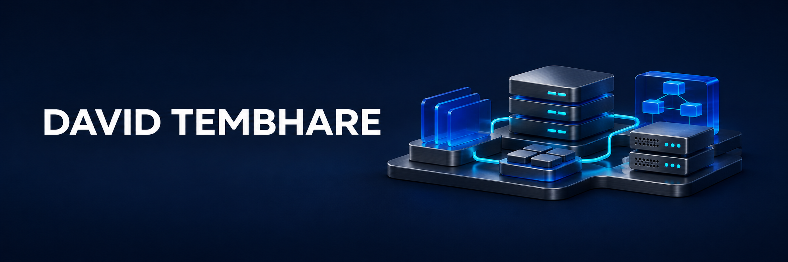

  

  <picture>
    <source media="(prefers-color-scheme: dark)" srcset="https://readme-typing-svg.demolab.com?font=Fira+Code&amp;size=16&amp;pause=1200&amp;color=58BFFF&amp;center=true&amp;vCenter=true&amp;width=460&amp;height=48&amp;lines=Full-Stack+Development;Agentic+AI;Networking+%26+Infrastructure;GDG+Organizer+%7C+E-CODE+Club+Head">
    
  </picture>

  
  
  
  
  

  

<h3 align="center">Tech stack</h3>

  

  

  

  

  
  
  
  
  
  

<h3 align="center">Projects &amp; achievements</h3>

  
  
  

  
  

  
Experience &amp; education

- **E-CODE Club Head** · Lead a 10-member team and organize programming contests and workshops. Built the LAN-based Code Clash platform with automated judging, a submission queue, and a live leaderboard.
- **GDG Organizer** · Plan events and support the developer community.
- **Freelance developer** · Delivered the official React and Node.js site for DESIFEST 2026, a Canadian festival with 150,000+ annual attendees.
- **Web Development Intern · Online Dimensions, Lebanon** · Contributed to applications supporting 30,000+ monthly active users.
- **B.Tech, Computer Science and Engineering (AI)** · J.K. Institute, University of Allahabad · Expected 2028.

Competitive programming ratings are from my November 2026 résumé.

